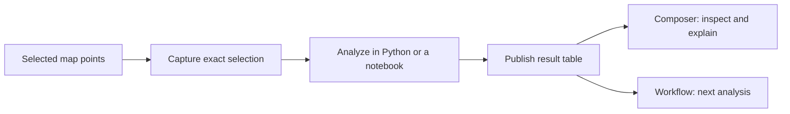
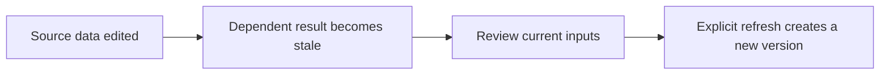

# Mantis SDK

Work with Mantis from Python: read maps, run notebook cells, use workflows, and send results back to the app.

The shared-data helpers let these tools use **the same selected records and the same result versions**. You can analyze a selection without exporting a CSV and manually matching it to a later result.

[Walkthrough](#walkthrough-selected-points-to-a-reusable-result) · [Installation](#installation) · [API guide](docs/usage.md) · [Examples](examples)

## What this makes possible

Imagine selecting 500 records on a map. You calculate a summary in a notebook, then ask Composer to explain it or pass it to a workflow. Each tool can use the exact selection or result you published, with its source history attached.



| Step | What carries over |
| --- | --- |
| Capture a selection | Exact point IDs, chosen columns and source data version |
| Load it into Python | A pandas DataFrame containing those rows |
| Publish a result | A reusable table linked to the inputs that produced it |
| Use it elsewhere | A reference to the same stored result |
| Change the original data | A stale status, so changed inputs are visible |

**Availability:** these SDK additions are in [PR #25](https://github.com/KellisLab/Mantis_SDK/pull/25). The matching backend is [deployed and verified](https://github.com/KellisLab/MantisAPI/actions/runs/42417404823); the SDK additions have not been published to PyPI. Use the source branch below while the PR is under review. Existing account access rules still apply.

## Installation

Requires Python 3.10 or newer.

```bash
git clone https://github.com/KellisLab/Mantis_SDK.git
cd Mantis_SDK

# While PR #25 is pending, use its branch for the shared-data helpers:
git switch codex/shared-object-handoff

python -m venv .venv
source .venv/bin/activate         # Windows: .venv\Scripts\activate
pip install -e .
```

| If you need… | Install |
| --- | --- |
| REST requests and pandas tables | `pip install -e .` |
| NumPy matrices and Parquet item tables | `pip install -e ".[data]"` |
| Browser control and screenshots | `pip install -e ".[browser]"`, then `python -m playwright install chromium` |
| Development tools | `pip install -e ".[dev]"` |

## Connect to Mantis

Keep connection settings and credentials in your private environment. `MantisClient.from_env()` reads them.

| Variable | Purpose |
| --- | --- |
| `MANTIS_HOST` | Origin receiving REST requests: your frontend proxy or backend |
| `MANTIS_BASE_URL` | `/api/proxy/` for the frontend proxy; `/` for direct backend requests |
| `MANTIS_COOKIE` | Your authenticated session cookies |
| `MANTIS_BACKEND_HOST` | Backend origin, also used for agent WebSockets |

```python
from mantis_sdk import MantisClient

client = MantisClient.from_env()
```

**For `client.objects`:** the SDK requires valid Django `sessionid` and `csrftoken` cookies and sends the matching CSRF header. Internal-service credentials alone do not authorize these helpers. Keep cookies out of source control and shared notebook cells.

The [authentication guide](docs/usage.md#authentication) covers other SDK endpoints and internal-service connections.

## Walkthrough: selected points to a reusable result

Use `space_id`, `map_id`, and `selected_ids` from a workspace you can access. This example assumes it has `topic` and `score` columns; use your actual field names.

### 1. Capture the selection and load its rows

A **cohort** is a saved, exact selection of records.

```python
cohort = client.objects.capture_cohort(
    space_id, map_id,
    point_ids=selected_ids,
    columns=["topic", "score"],
    name="Selected records",
    reviewed=True,
)

frame = client.objects.dataframe(space_id, map_id, cohort)
```

### 2. Calculate a result and publish it with its inputs

```python
summary = frame.groupby("topic", as_index=False)["score"].sum()

result = client.objects.publish_dataframe(
    space_id, map_id, summary,
    inputs=[cohort],
    name="Score totals by topic",
    reviewed=True,
)

print(result["uri"], result["version"])
```

`inputs=[cohort]` records which selection produced the summary. Composer can inspect that published table; another SDK call or workflow can read the same version.

### 3. Pass the result to a workflow

```python
workflow = client.objects.operation_workflow("row_count")
request = client.objects.workflow_input(space_id, map_id, [result])

run = client.objects.run_workflow(workflow, request)
status = client.objects.execution(run["execution_id"])
```

Execution is asynchronous: read `execution(...)` again to check progress. Here, `row_count` counts the summary's topic rows. The backend checks access and input versions again when the worker starts.

## How the shared reference works

| Field | Plain meaning |
| --- | --- |
| `uri` | Which stored selection or result |
| `version` | Which revision of it |
| `content_hash` | A checksum identifying its contents |
| Input references / lineage | Which exact inputs produced it |

Pass these references between tools instead of copying data into each request. The server resolves them and checks access. Results remain private to the authenticated author.

```python
history = client.objects.lineage(space_id, map_id, result)
```

### When the original data changes



| Result type | How to update it |
| --- | --- |
| Registered operation, such as a group count | Resolve its latest reference, review it, then call `refresh(..., reviewed=True, cascade=True)` |
| Table calculated by your Python code | Recompute it and publish again with current inputs; use `target=` to create a new version of the same table |

Reading a result does not refresh it automatically. `allow_stale=True` explicitly allows retained older contents when source access is still valid. Arbitrary Python code is not replayed automatically.

## Methods at a glance

| Goal | `client.objects` methods |
| --- | --- |
| Save a selection | `capture_cohort` |
| Inspect available fields and operations | `options` |
| Read a table | `read_table`, `dataframe` |
| Save calculated rows | `publish_table`, `publish_dataframe` |
| Run a registered analysis | `run_operation` |
| Trace or update a result | `lineage`, `resolve`, `refresh` |
| Reuse a Rep-SI build output | `import_artifact`, `download` |
| Read a Rep-SI matrix and its row order | `representation`, `representation_items` |
| Submit and follow a workflow | `operation_workflow`, `workflow_input`, `run_workflow`, `execution` |

### Registered analyses

Call `client.objects.options(space_id, map_id)` for the available operations and their parameter schemas.

| Operation | Use it for |
| --- | --- |
| `group_counts` | Count rows by a field, such as topic |
| `numeric_summary` | Summarize a numeric field |
| `filter_equals` | Keep rows matching a field value |
| `row_count` | Count input rows |

### Files and matrices

Use `import_artifact(..., build_artifact_id=..., reviewed=True)` for an accessible Rep-SI build file, or `representation_id=...` for a matrix. `download` returns original bytes; `representation` loads the matrix; `representation_items` returns the corresponding rows in their stored order.

Install the `data` extra for matrix and Parquet support. Build permissions are checked again on reads; knowing a checksum does not grant access.

### Writes and limits

| Behavior | What to expect |
| --- | --- |
| Review | Writes require `reviewed=True`; review the input scope before submitting |
| Retry | Supply one UUID as `request_id` and reuse it with the exact same body; a changed body is rejected |
| Materialization | 32 MB, 200,000 rows and 64 columns; oversized requests fail without silent truncation |
| Changed or inaccessible inputs | Resolve and review again; workflows do not silently substitute newer data |

## The rest of the SDK

| Area | Entry point | Guide |
| --- | --- | --- |
| Spaces and maps | `client.spaces`, `client.maps` | [Resource API](docs/usage.md#resource-oriented-api) |
| Notebook cells and plots | `client.notebooks` | [Notebooks](docs/usage.md#notebooks) |
| Coding agents | `client.agents` | [Agents](docs/usage.md#agents-provider-scoped) |
| Annotations and search | `client.annotations`, `client.search` | [Resource API](docs/usage.md#resource-oriented-api) |
| Browser actions and screenshots | `client.spaces.aopen(...)` | [Browser automation](docs/usage.md#browser-automation) |
| Exceptions | `MantisError` and its subclasses | [Errors](docs/usage.md#errors) |

Existing passage, claim and workflow-result objects can also be resolved through `client.objects.resolve(...)` and passed to `workflow_input(...)`.

Inside Mantis notebook cell tools, the synchronous helpers `readTable`, `publishTable`, `runObjectOperation`, `readArtifact`, `readRepresentation`, and `readRepresentationItems` use the notebook's signed credential. Browser cookies do not need to be embedded in notebook code.

See the [full usage guide](docs/usage.md), [runnable examples](examples), and [changelog](CHANGELOG.md) for more.
