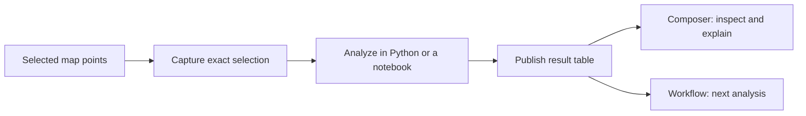
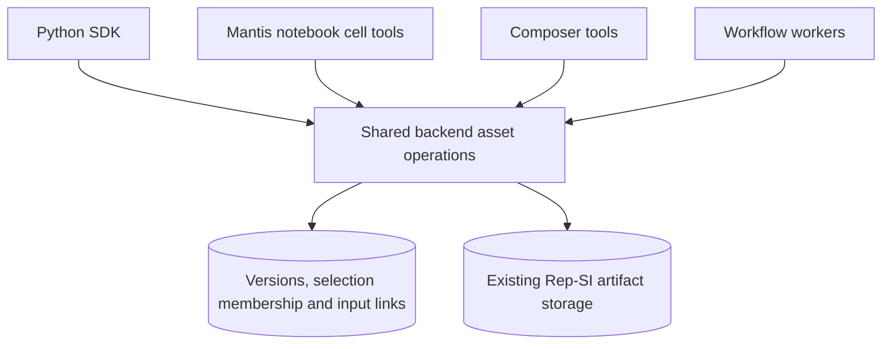
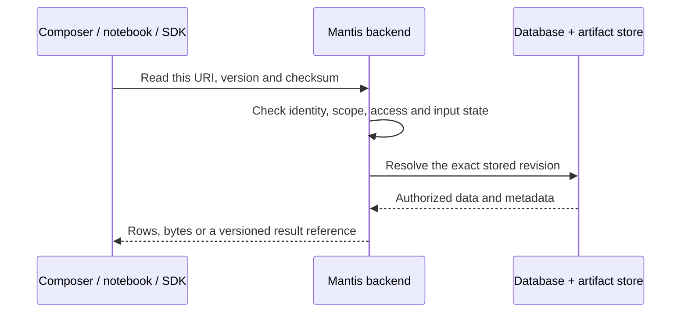
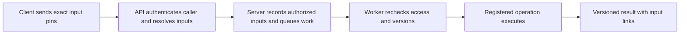
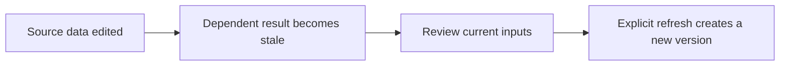

# Mantis SDK

Work with Mantis from Python: read maps, run notebook cells, use workflows, and send results back to the app.

This update gives Composer, notebook cell tools, Python scripts and workflow workers a common way to use **the same selected records and the same saved result versions**. An analysis can move between these tools without losing which data it used or whether that data has changed.

[Why this matters](#what-this-makes-possible) · [What we built](#what-we-implemented) · [How it works](#what-unified-means) · [Try it](#walkthrough-selected-points-to-a-reusable-result) · [Release and testing](#release-status-and-validation) · [API guide](docs/usage.md)

## What this makes possible

Imagine selecting 500 records on a map. You calculate a summary in a notebook, then ask Composer to explain it or pass it to a workflow. Each tool can use the exact selection or result you published, with its source history attached.

The bottleneck this addresses is **the handoff between tools**. APIs already let tools perform work. This layer gives that work a stable identity, explicit inputs and a way to be reused and checked later.



| Step | What carries over |
| --- | --- |
| Capture a selection | Exact point IDs, chosen columns, source identities and captured field contents |
| Load it into Python | A pandas DataFrame containing those rows |
| Publish a result | A reusable table linked to the inputs that produced it |
| Use it elsewhere | A reference to the same stored result |
| Change the original data | A stale status, so changed inputs are visible |

| Without using this shared path | With this shared path |
| --- | --- |
| A selection or exported table needs to be passed around and matched manually | Save the exact selection once and pass its reference |
| A notebook result can stay inside the notebook session | Publish it as a stored table that survives the session |
| A later analysis may use a different selection or a newer input | Request an explicit version; reject invalid or changed inputs |
| It takes separate bookkeeping to connect an output to its inputs | Inspect the stored input links and stale status |

For example, “summarize these 500 records, then count the summary rows in a workflow” becomes one connected pipeline. It does not mean Composer automatically knows about every Python variable: the calculation must be published, and its reference must be supplied to the next tool.

## What we implemented

There are two parts: shared backend operations in **MantisAPI**, and Python helpers in **this SDK**. The backend work extends Mantis's existing object versions and Rep-SI artifact storage. Rep-SI is the existing computation and artifact system; this update connects its outputs to the shared object contract.

| Part | What it does |
| --- | --- |
| Exact selections, called cohorts | Records which points and columns you chose, their source row identities, and hashes of their contents |
| Shared tables | Stores calculated rows as a versioned result that another tool can read |
| Artifact and matrix adapters | Makes accessible Rep-SI files and matrices usable through the same reference format, including matrix row order |
| Common operation catalog | Gives tools the same definitions for counting, filtering and numeric summaries |
| Input history | Links each published result to the exact input versions it used |
| Staleness and explicit refresh | Detects changed inputs and creates a new result version when you choose to refresh |
| Workflow admission | Checks the caller and inputs before queuing work, then checks again when a worker starts |
| SDK helpers | Handles requests, CSRF headers, DataFrame conversion, binary downloads and workflow submission from Python |

### The terms, in plain language

| Term | Meaning here |
| --- | --- |
| Object | An addressable selection, result or supported source, with a stable ID |
| Version | One saved revision of that object; creating a newer revision does not overwrite its predecessor |
| Cohort | The exact records and columns selected for an analysis, saved independently of map layout |
| Table | Rows calculated in Python or by a registered operation, then published for reuse |
| Artifact | Stored output bytes, such as a file or matrix, managed by the existing artifact store |
| Representation | A matrix together with the item IDs and row order that give its numbers meaning |
| Pin / reference | An object's URI, version and content checksum, used to request that exact revision |
| Lineage | Links from a result to the input versions declared when it was published |
| Stale | The recorded inputs have changed; the result needs review before normal reuse |

“Persistent” means the saved selection or published result survives a notebook or browser session. It does not mean every temporary DataFrame is automatically saved.

### What “unified” means

Each tool agrees on a reference to a stored version: **object URI + version + content hash**. Python can load that version into a DataFrame; Composer can inspect its rows; a workflow can use it as an input.



The metadata records identity and history. The artifact store holds the data being read. Requests carry references, and the backend resolves them under the caller's permissions.

| Stored in the database | Stored in the existing artifact store |
| --- | --- |
| Object identity, versions, selection membership, source bindings, input links and operation records | Serialized table data, original files, matrix chunks and item-order tables |

The tools still call the backend API. They do not switch to calling artifacts directly. The object's `content_hash` checks its saved content descriptor, which includes the artifact reference; the artifact has its own digest for the stored bytes. Neither hash is a storage URL or permission to download data.



This is a shared data contract across the supported paths, rather than a rewrite of every backend endpoint. Existing engines still do the work. New operations and tool integrations must explicitly adopt this contract to gain its guarantees.

### A concrete example

1. **Select 500 records.** Capture their IDs and the `topic` and `score` columns as a cohort.
2. **Calculate topic totals in Python.** Load those exact rows, group them by topic, and add the scores.
3. **Publish the summary.** The new table records the cohort version it came from.
4. **Reuse it.** Ask Composer to inspect the published reference, or give it to a workflow. Both can use the same stored summary.
5. **Edit the source later.** The summary becomes stale. Recompute your Python calculation and publish a new version, or explicitly refresh a registered operation.

This lets a result keep its meaning as it moves between tools: which records were included, which input versions it used, and whether those inputs have changed.

### Which tools use it?

| Surface | How it participates |
| --- | --- |
| Composer | Tools discover the catalog, capture selected points, run a registered operation, inspect a result and explicitly refresh it |
| Mantis notebook cell tools | Synchronous helpers load saved tables into DataFrames and publish calculated results through the signed notebook bridge |
| Python SDK | `client.objects` exposes the same data operations to scripts and notebooks using an authenticated session |
| Jarvis asynchronous workflows | An `object_operation` node uses admitted inputs or an earlier node's output from the same execution |

This uses the existing Composer notebook `add_cell` / `execute_cell` path. It does not automatically integrate the separate file-browser AgentRuntime Jupyter environment. It also does not make every workflow engine, webhook or legacy endpoint understand typed object inputs.

### What happens when a workflow runs?



The client submits `mantis.object-request/v1`. The server creates the authorized `mantis.object-input/v1` context. The caller cannot turn a copied reference into authority by adding an actor ID or claimed provenance. Checks run again when queued work starts because permissions or source data may have changed while it waited.

### What this PR changes

| Location | Responsibility |
| --- | --- |
| [Backend PR #5294](https://github.com/KellisLab/MantisAPI/pull/5294) | Storage bindings, selected-record membership, operations, dependencies, refresh, notebook/Composer adapters and workflow enforcement |
| [This SDK PR #25](https://github.com/KellisLab/Mantis_SDK/pull/25) | Python methods for those operations, DataFrame/file/matrix handling, workflow helpers, tests and documentation |
| Mantis app | Uses its existing Composer and notebook cell tools; this change does not require another panel |

| We added | We reused |
| --- | --- |
| Computational selection/table bindings and input dependency records | Existing semantic object identities and versions |
| Shared operation schemas and adapters for files and matrices | Rep-SI execution steps and artifact storage |
| Explicit refresh and downstream stale checks | Existing map data and permission boundaries |
| Composer/notebook/SDK adapters and typed workflow admission | Composer, notebook cell execution and the Jarvis worker engine |

The backend migration is additive: it adds computational asset records and optional links to existing object versions. Existing API paths remain available. There is no new “saved analysis” panel in this change.

### The architectural inspiration

Palantir's [Foundry Ontology](https://www.palantir.com/docs/foundry/ontology/overview) brings shared objects, relationships and operations into applications under common governance. The useful pattern here is that multiple tools should work with the same meaningful objects rather than each inventing its own data handoff.

Our implementation applies that pattern to Mantis selections, tables and supported build outputs. Its scope is narrower: it does not introduce a complete enterprise ontology, generated domain-specific SDKs or a general business-action system.

**Availability:** the matching backend is deployed for its existing enabled-account rollout. These Python additions are in [SDK PR #25](https://github.com/KellisLab/Mantis_SDK/pull/25) and have not been published to PyPI. Use the source branch below while the PR is under review. See [release status and validation](#release-status-and-validation) for the checks and remaining release steps.

## Installation

Requires Python 3.10 or newer.

```bash
git clone https://github.com/KellisLab/Mantis_SDK.git
cd Mantis_SDK

# While PR #25 is pending, use its branch for the shared-data helpers:
git switch codex/shared-object-handoff

python -m venv .venv
source .venv/bin/activate         # Windows: .venv\Scripts\activate
pip install -e .
```

| If you need… | Install |
| --- | --- |
| REST requests and pandas tables | `pip install -e .` |
| NumPy matrices and Parquet item tables | `pip install -e ".[data]"` |
| Browser control and screenshots | `pip install -e ".[browser]"`, then `python -m playwright install chromium` |
| Development tools | `pip install -e ".[dev]"` |

## Connect to Mantis

Keep connection settings and credentials in your private environment. `MantisClient.from_env()` reads them.

| Variable | Purpose |
| --- | --- |
| `MANTIS_HOST` | Origin receiving REST requests: your frontend proxy or backend |
| `MANTIS_BASE_URL` | `/api/proxy/` for the frontend proxy; `/` for direct backend requests |
| `MANTIS_COOKIE` | Your authenticated session cookies |
| `MANTIS_BACKEND_HOST` | Backend origin, also used for agent WebSockets |

```python
from mantis_sdk import MantisClient

client = MantisClient.from_env()
```

**For `client.objects`:** the SDK requires valid Django `sessionid` and `csrftoken` cookies and sends the matching CSRF header. Internal-service credentials alone do not authorize these helpers. Keep cookies out of source control and shared notebook cells.

The [authentication guide](docs/usage.md#authentication) covers other SDK endpoints and internal-service connections.

## Walkthrough: selected points to a reusable result

Use `space_id`, `map_id`, and `selected_ids` from a workspace you can access. This example assumes it has `topic` and `score` columns; use your actual field names.

### 1. Capture the selection and load its rows

A **cohort** is a saved, exact selection of records.

```python
cohort = client.objects.capture_cohort(
    space_id, map_id,
    point_ids=selected_ids,
    columns=["topic", "score"],
    name="Selected records",
    reviewed=True,
)

frame = client.objects.dataframe(space_id, map_id, cohort)
```

### 2. Calculate a result and publish it with its inputs

```python
summary = frame.groupby("topic", as_index=False)["score"].sum()

result = client.objects.publish_dataframe(
    space_id, map_id, summary,
    inputs=[cohort],
    name="Score totals by topic",
    reviewed=True,
)

print(result["uri"], result["version"])
```

`inputs=[cohort]` records which selection produced the summary. Composer can inspect that published table; another SDK call or workflow can read the same version.

The backend records the dependencies you supply. It does not inspect arbitrary Python to prove the calculation is correct, discover undeclared inputs or capture the code needed to rerun it.

For a built-in calculation, the backend can also record and rerun the operation itself:

```python
counts = client.objects.run_operation(
    space_id, map_id, cohort,
    "group_counts",
    parameters={"field": "topic"},
    name="Selected records by topic",
    reviewed=True,
)
```

This counts actual rows by topic, including missing values. It does not ask a language model to estimate the distribution.

### 3. Pass the result to a workflow

```python
workflow = client.objects.operation_workflow("row_count")
request = client.objects.workflow_input(space_id, map_id, [result])

run = client.objects.run_workflow(workflow, request)
status = client.objects.execution(run["execution_id"])
```

Execution is asynchronous: read `execution(...)` again to check progress. Here, `row_count` counts the summary's topic rows. The backend checks access and input versions again when the worker starts.

## How the shared reference works

| Field | Plain meaning |
| --- | --- |
| `uri` | Which stored selection or result |
| `version` | Which revision of it |
| `content_hash` | A checksum of the saved object content, including its artifact reference |
| Input references / lineage | Which exact inputs produced it |

Pass these references between tools instead of copying data into each request. The server resolves them and checks access. Derived assets are private to the authenticated author, including in a shared Space; this feature does not add cross-user result sharing.

“Same result” means the same stored revision. Loading it into pandas creates an in-memory DataFrame; editing that DataFrame does not mutate the saved table. Publish again to save a new result.

```python
history = client.objects.lineage(space_id, map_id, result)
```

### When the original data changes



| Result type | How to update it |
| --- | --- |
| Registered operation, such as a group count | Resolve its latest reference, review it, then call `refresh(..., reviewed=True, cascade=True)` |
| Table calculated by your Python code | Recompute it and publish again with current inputs; use `target=` to create a new version of the same table |

Reading a result does not refresh it automatically. `allow_stale=True` explicitly allows retained older contents when source access is still valid. Arbitrary Python code is not replayed automatically.

| What changed? | Expected behavior |
| --- | --- |
| A selected record's captured field changes | The cohort and its dependent result become stale when checked |
| An unrelated, uncaptured field changes | That change alone does not stale the selected projection |
| New points are added to the map | They do not silently join an existing cohort |
| The map layout changes | Selection membership stays tied to record IDs, not screen positions |
| A selected source is deleted or its dataset is replaced | Reads or refreshes that require that original are blocked |
| Source access is revoked | A saved reference, checksum or `allow_stale=True` cannot bypass it |
| A result gets a newer version | Earlier bytes remain immutable; reading them still requires valid access |

Staleness is checked during reads and resolution. There is no background process that continuously recomputes every downstream result. Refresh is an explicit write, and cascading refresh only handles supported registered recipes and cohorts.

## Access, review and retries

| Boundary | How it works |
| --- | --- |
| SDK requests | Django session and CSRF cookies; internal-service credentials alone are insufficient for `client.objects` |
| Composer requests | Identity comes from the authenticated server-side chat context |
| Notebook requests | A verified signed notebook credential and active server-side credential record; no browser cookie needs to be placed in a cell |
| Queued work | The server records the caller at admission; the worker rechecks current access before execution |
| Writes | Require editor rights and explicit `reviewed=True` scope acknowledgment |
| Imported build output | Original Build/source permissions are checked again on reads |
| Retries | A request UUID is bound to its body; the same UUID and body reuse the result, while a changed body conflicts |

`reviewed=True` is an explicit caller acknowledgment, not a separate human approval service or a correctness certificate. The backend still validates permissions, references, schemas and limits.

For a retryable write, generate one UUID before submitting and keep both it and the request body unchanged across retries. If omitted, the SDK generates a new UUID on each call.

## Methods at a glance

| Goal | `client.objects` methods |
| --- | --- |
| Save a selection | `capture_cohort` |
| Inspect available fields and operations | `options` |
| Read a table | `read_table`, `dataframe` |
| Save calculated rows | `publish_table`, `publish_dataframe` |
| Run a registered analysis | `run_operation` |
| Trace or update a result | `lineage`, `resolve`, `refresh` |
| Reuse a Rep-SI build output | `import_artifact`, `download` |
| Read a Rep-SI matrix and its row order | `representation`, `representation_items` |
| Submit and follow a workflow | `operation_workflow`, `workflow_input`, `run_workflow`, `execution` |

### Registered analyses

Call `client.objects.options(space_id, map_id)` for the available operations and their parameter schemas.

| Operation | Use it for |
| --- | --- |
| `group_counts` | Count rows by an exact scalar field value, including missing values; requires `field` |
| `numeric_summary` | Return count, missing count, sum, min, max and mean; requires `field` containing finite numbers or missing values |
| `filter_equals` | Keep rows matching an exact JSON scalar, preserving row identities; requires `field` and `value` |
| `row_count` | Count every row in the pinned input; no parameters |

These are versioned Rep-SI operations over cohorts or tables. They validate parameter schemas and create private result tables without modifying the sources. They make no model calls and do not execute arbitrary submitted Python or SQL.

### Files and matrices

Use `import_artifact(..., build_artifact_id=..., reviewed=True)` for an accessible Rep-SI build file, or `representation_id=...` for a matrix. `download` returns original bytes; `representation` loads the matrix; `representation_items` returns the corresponding rows in their stored order.

Install the `data` extra for matrix and Parquet support. Build permissions are checked again on reads; knowing a checksum does not grant access.

The matrix and its item table must stay together: matrix row 20 is meaningful only if you know which item has ordinal 20. The adapters preserve that alignment and check matrix shape, finite values and contiguous item order.

### Writes and limits

| Behavior | What to expect |
| --- | --- |
| Review | Writes require `reviewed=True`; review the input scope before submitting |
| Retry | Supply one UUID as `request_id` and reuse it with the exact same body; a changed body is rejected |
| Materialization | 32 MiB, 200,000 rows and 64 columns; oversized requests fail without silent truncation |
| Selected record size | At most 64 KiB of captured field content per record |
| Table read page | At most 1,000 rows; use pagination or the bounded DataFrame download |
| Workflow input helper | 1–10 pinned references per request |
| Dependency inspection and refresh | Bounded traversal: up to 100 versions for lineage, with refresh depth and operation budgets of 16 |
| Object history | Up to 500 saved versions per object |
| Changed or inaccessible inputs | Resolve and review again; workflows do not silently substitute newer data |

This is a bounded materialization interface, not a new distributed query engine. It will reject an oversized operation rather than quietly analyze a sample.

## Release status and validation

The following records describe this implementation's validation and release as of **November 7, 2026**. A completed test run is evidence for that revision, rather than a promise that every unrelated Mantis feature is covered.

| Component | Status |
| --- | --- |
| Shared backend runtime | Deployed and verified within the existing enabled-account rollout; API and worker release images checked |
| SDK implementation | Present in [PR #25](https://github.com/KellisLab/Mantis_SDK/pull/25); awaiting independent approving review and merge |
| Python package release | Not published; publishing setup and the existing PyPI/source version history must be reconciled before release |
| New frontend panels | None required or added by this change |

| Validation | What it covered | Evidence |
| --- | --- | --- |
| Backend release CI | 25,617 tests across four unit shards, plus migration, static, ASGI/SDK and real notebook-container checks | [Release CI](https://github.com/KellisLab/MantisAPI/actions/runs/42414396120) |
| Staged live integration | Authenticated session/CSRF, real storage, signed notebook reads and publication, Composer inspection of the notebook result, workflow lifecycle, refresh and revocation | [Live canary](https://github.com/KellisLab/MantisAPI/actions/runs/42415874032) |
| Production integration | Exact cohort counts; real broker/worker execution; serving notebook bridge; shared table reads; stale denial; explicit cascading refresh; immutable history; revoked credential/access denial; fixture cleanup | [Production verification](https://github.com/KellisLab/MantisAPI/actions/runs/42417404823) |
| Release consistency | API/worker image alignment, preserved rollout flags and rollback configuration | [Read-only release check](https://github.com/KellisLab/MantisAPI/actions/runs/42417640285) |
| SDK implementation checks | 102 tests passed; Python 3.10, 3.11 and 3.12 CI and wheel checks passed before subsequent documentation-only edits | [SDK PR checks](https://github.com/KellisLab/Mantis_SDK/pull/25/checks) |

These checks include real service boundaries, not only mocked HTTP calls. The current SDK README examples use placeholders for your own accessible Space, map and field names; they are not credentials or a built-in sample dataset.

## Implementation map for maintainers

| Layer | Main files | Responsibility |
| --- | --- | --- |
| Python client | [`mantis_sdk/client.py`](mantis_sdk/client.py), [`mantis_sdk/objects.py`](mantis_sdk/objects.py) | Resource methods, pinned inputs, table/matrix conversion and workflow submission |
| SDK transport | [`mantis_sdk/_http.py`](mantis_sdk/_http.py), [`mantis_sdk/transport.py`](mantis_sdk/transport.py) | Authenticated requests, URL handling and binary responses |
| SDK regression coverage | [`tests/test_objects.py`](tests/test_objects.py), [`tests/test_asset_objects.py`](tests/test_asset_objects.py) | Reference validation, request contracts, auth, DataFrames, artifacts and workflows |
| Backend assets | `src/knowledge/assets.py`, `asset_contract.py`, `asset_operations.py` in MantisAPI | Capture, publication, reads, catalog, storage bindings, lineage and refresh |
| Backend schema | `src/knowledge/models.py`, migration `0028_computational_assets.py` in MantisAPI | Computational asset members, dependencies, parts and run records |
| Composer and notebooks | `src/knowledge/asset_composer.py`, `src/mantisnotebook/commands/assets.py`, `src/notebook_bridge/server.py` in MantisAPI | Tool adapters and the signed synchronous data bridge |
| Workflow execution | `src/orchestration/object_admission.py`, `object_context.py`, `jarvis_nodes/object_operation.py` in MantisAPI | Typed input admission, execution context and worker checks |

Backend implementation: [MantisAPI PR #5294](https://github.com/KellisLab/MantisAPI/pull/5294), with the notebook HTTP route correction in [PR #5296](https://github.com/KellisLab/MantisAPI/pull/5296). The [SDK usage guide](docs/usage.md#implementation-map) contains additional adapter and authentication notes.

## The rest of the SDK

| Area | Entry point | Guide |
| --- | --- | --- |
| Spaces and maps | `client.spaces`, `client.maps` | [Resource API](docs/usage.md#resource-oriented-api) |
| Notebook cells and plots | `client.notebooks` | [Notebooks](docs/usage.md#notebooks) |
| Coding agents | `client.agents` | [Agents](docs/usage.md#agents-provider-scoped) |
| Annotations and search | `client.annotations`, `client.search` | [Resource API](docs/usage.md#resource-oriented-api) |
| Browser actions and screenshots | `client.spaces.aopen(...)` | [Browser automation](docs/usage.md#browser-automation) |
| Exceptions | `MantisError` and its subclasses | [Errors](docs/usage.md#errors) |

Existing passage, claim and workflow-result objects can also be resolved through `client.objects.resolve(...)` and passed to `workflow_input(...)`.

Inside Mantis notebook cell tools, the synchronous helpers `readTable`, `publishTable`, `runObjectOperation`, `readArtifact`, `readRepresentation`, and `readRepresentationItems` use the notebook's signed credential. Browser cookies do not need to be embedded in notebook code.

The notebook helpers and Python SDK have different response wrappers: `client.objects.publish_dataframe(...)` returns the object directly; notebook `publishTable(...)` returns an envelope whose `"object"` field contains that reference. Use that field when passing a notebook publication to another operation.

See the [full usage guide](docs/usage.md), [runnable examples](examples), and [changelog](CHANGELOG.md) for more.
